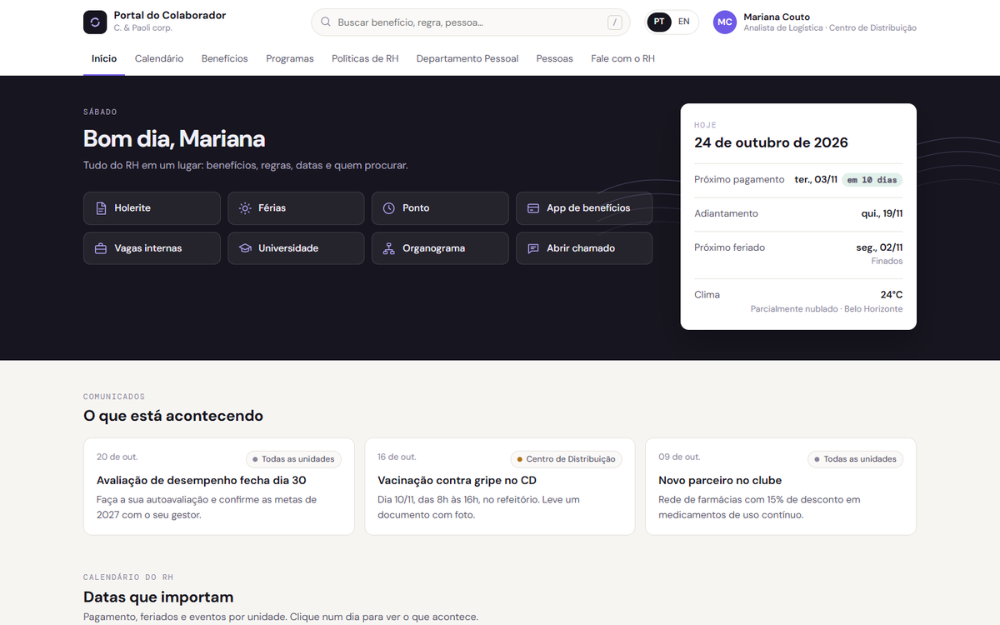
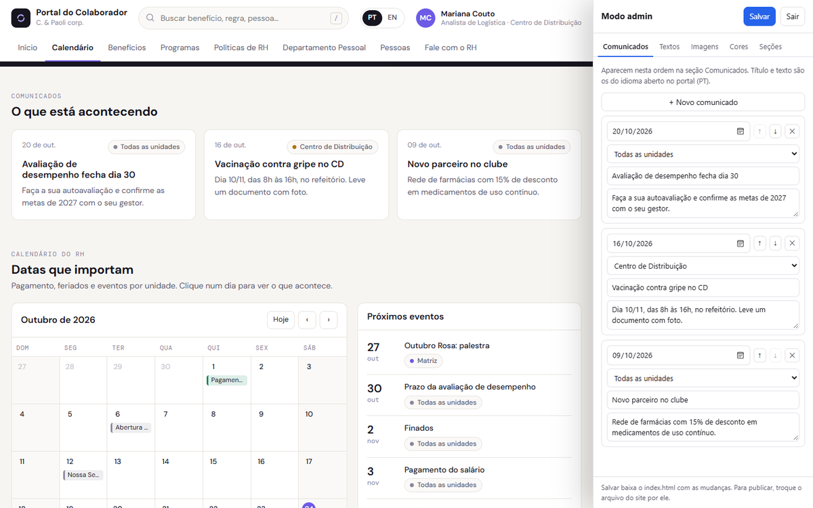

# Portal do Colaborador · C. & Paoli corp.

Portal de RH em uma página: benefícios, programas, políticas, departamento pessoal, calendário, aniversariantes e atendimento. Em português e inglês, tema claro e escuro. A empresa, as pessoas e os dados são **fictícios** (é a mesma empresa do painel de indicadores de RH deste portfólio). Tem um **modo admin** para o RH editar os comunicados e trocar textos, logo, cores e a ordem das seções sem mexer no código.



O mesmo modo admin é usado no [Alcova Residência Executiva](https://github.com/FernandoTRecruiter/alcova-flat-executivo).

## Por que existe

Nasceu de uma reformulação de portal de RH que fiz no SharePoint. Lá, o portal tinha de ser montado só com os web parts nativos, para o RH manter sozinho: sem busca dentro do conteúdo, sem calendário que calcula datas e sem cartões que mudam conforme a unidade da pessoa. Esta versão responde: **como seria o mesmo portal sem essas amarras, com a manutenção ao alcance do RH?**

| Pergunta do colaborador | Onde o portal responde |
|---|---|
| "Quando cai o salário?" | Quadro **Hoje**: próximo pagamento com contagem de dias, adiantamento e próximo feriado, calculados pela regra (1º dia útil, dia 20) e pelos feriados |
| "Eu tenho direito a isso?" | Cada cartão mostra as unidades. Em Benefícios, o filtro "Ver para" esmaece o que não vale para a unidade escolhida, e o cartão marca "inclui você" |
| "Como faço para pedir?" | Popup do item com a mesma anatomia sempre: o que é, quem tem direito, como usar (passos) e a quem perguntar |
| "Onde está aquilo?" | Busca no topo (atalho `/`) em itens, contatos e comunicados, sem acento e com teclado |
| "Com quem eu falo?" | Contatos por assunto, com e-mail que copia no clique, e **Abrir chamado** em popup |

## O que tem

- **Boas-vindas** com saudação pela hora do dia, 8 atalhos e o quadro Hoje.
- **Comunicados** marcados por unidade.
- **Calendário** mensal com pagamento, adiantamento, feriados e eventos por unidade.
- **4 categorias** com 16 cartões. Cada cartão abre um popup e tem link próprio (`index.html#ferias` abre direto o de férias).
- **Pessoas:** aniversariantes do mês e tempo de casa.
- **Fale com o RH:** contatos por assunto (com foto opcional) e chamado com anexo e protocolo.
- **PT e EN** completos; a escolha fica salva no navegador.

## Rodar e publicar

- **No computador:** abra o `index.html` no navegador.
- **Publicar de graça no GitHub Pages:** suba a pasta para um repositório, vá em **Settings > Pages > Deploy from a branch** e escolha `main` e `/ (root)`. Em 1 a 2 minutos o portal fica em `https://SEU-USUARIO.github.io/NOME-DO-REPOSITORIO/`. Para um portal interno de verdade, veja [Levar para produção](#levar-para-produção): ele precisa de login.

## Modo admin



1. Clique em **Personalizar** no rodapé (ou acrescente `#admin` ao endereço).
2. Edite. A aba **Comunicados** abre primeiro: data, unidade, título e texto de cada comunicado, com **+ Novo comunicado**, **↑ ↓** para ordenar e **✕** para remover; a seção da página muda na hora. Para os outros textos, clique no texto do portal e escreva, ou use a aba **Textos** (agrupados pelo lugar da página, com busca). Textos e comunicados são **por idioma**: troque PT/EN no topo para editar a outra versão, e mantenha marcadores como `{n}`, que o portal troca pelo número. As outras abas: **Imagens** (logo e fundo da faixa de boas-vindas), **Cores** (destaque e faixa, nos temas claro e escuro) e **Seções** (ordem e o que aparece; o menu acompanha).
3. Clique em **Salvar** (ou Ctrl+S): o navegador baixa um `index.html` novo, com as mudanças dentro. Com o portal aberto direto do computador, ele pede antes o `index.html` atual.
4. **Para publicar, troque o `index.html` do portal pelo baixado.**

Cartões, calendário, contatos e atalhos ficam nos blocos do `index.html` listados abaixo e se editam ali, num editor de texto. O modo admin não tem senha: qualquer pessoa abre, mas o portal só muda quando o dono troca o arquivo publicado.

## Onde está cada conteúdo

| Parte do `index.html` | O que é |
|---|---|
| `<script id="config">` | pessoa logada, unidades, regra de pagamento, feriados, eventos, atalhos, contatos, aniversários, comunicados e `chamadoEndpoint` (vazio = chamado simulado) |
| `<script id="itens">` | os 16 cartões: `id`, `cat` (ben, prog, pol, dp), `icone`, `quem`, `contato` (posição na lista de contatos) e textos em `pt` e `en` |
| `TXT` (no JavaScript) | rótulos fixos da interface nos dois idiomas |
| `<script id="personalizacao">` | o que o modo admin salvou, inclusive os comunicados editados (valem por cima dos do `config`); `{}` = portal original |

Para **adicionar um benefício**, copie um bloco do `itens` e troque o `id` e os textos: cartão, busca e link aparecem sozinhos.

## Levar para produção

Cada bloco de dados tem uma fonte natural numa empresa que usa Microsoft 365:

| Dado | Na demo | Em produção |
|---|---|---|
| Quem está logado | `config.usuario` fixo | Microsoft Graph `/me` (nome, cargo, unidade) |
| Cartões | bloco `itens` | lista do SharePoint lida pelo Graph; o RH edita a lista |
| "Baixar card em PDF" | só avisa | link para o PDF na biblioteca de documentos |
| Feriados e eventos | `config` | lista do SharePoint ou calendário do Outlook do RH |
| Aniversariantes e tempo de casa | `config` | sistema de RH, **só de quem autorizou** a divulgação |
| Chamado | `chamadoEndpoint` vazio = simulado | fluxo do Power Automate com gatilho HTTP, ou a ferramenta de chamados. Recebe `assunto, unidade, texto, anexo, usuario, abertoEm` |
| Atalhos | `url` vazia = aviso | URLs dos sistemas (folha, ponto, benefícios) |

Onde hospedar: **Azure Static Web Apps com login Microsoft (Entra ID)**, que exige login corporativo sem mudar o código; ou **dentro do SharePoint**, pelo web part **Incorporar** apontando para a página hospedada (página moderna não aceita HTML próprio).

Cuidados: aniversário só com consentimento e sem ano (a demo mostra dia e mês); o chamado avisa para não mandar atestado, que é dado de saúde e tem canal próprio; quem escreve um cartão escreve as duas línguas (sem o inglês, o portal mostra o português).

## Decisões técnicas e limitações

- **Um arquivo, sem framework.** `dialog`, `Intl` (datas nos dois idiomas) e `IntersectionObserver` são do navegador.
- **Datas calculadas, não digitadas.** Pagamento e adiantamento saem da regra mais a lista de feriados.
- **Esmaecer em vez de esconder.** No filtro por unidade, o benefício que não vale fica apagado, não some. Sumir dá a impressão de que o benefício acabou.
- **Mesma anatomia em todo cartão.** O leitor aprende uma vez onde está "quem tem direito".
- **Só o que muda toda semana tem formulário.** O modo admin cuida dos comunicados (o que o RH mais edita), dos textos, do logo, das cores e da ordem; o resto dos dados fica em blocos JSON, que em produção viram listas do SharePoint.
- **Limitações:** clima é exemplo; a busca não tem sinônimos ("VR" não acha "vale-refeição"); uma unidade nova precisa de uma cor nova em `--u-*`; a lista de feriados precisa ser atualizada todo ano.

## Testar

```bash
pip install websocket-client
python ferramentas/teste_modo_admin.py
```

Abre o portal num Edge ou Chrome sem janela e confere: a página sem erro de JavaScript, comunicados, calendário, cartões e busca funcionando, o modo admin abrindo, uma edição de texto e um comunicado editado indo para o `index.html` baixado (com o resto do arquivo idêntico) e aparecendo para o visitante, e o mesmo caminho com o portal aberto direto do computador.

## Estrutura

```
index.html                 o portal inteiro (HTML, CSS, JS, dados e modo admin)
ferramentas/
  teste_modo_admin.py      teste do portal e do modo admin
  cdp_util.py              abre o Edge ou o Chrome sem janela para o teste
docs/                      capturas usadas neste README
```
